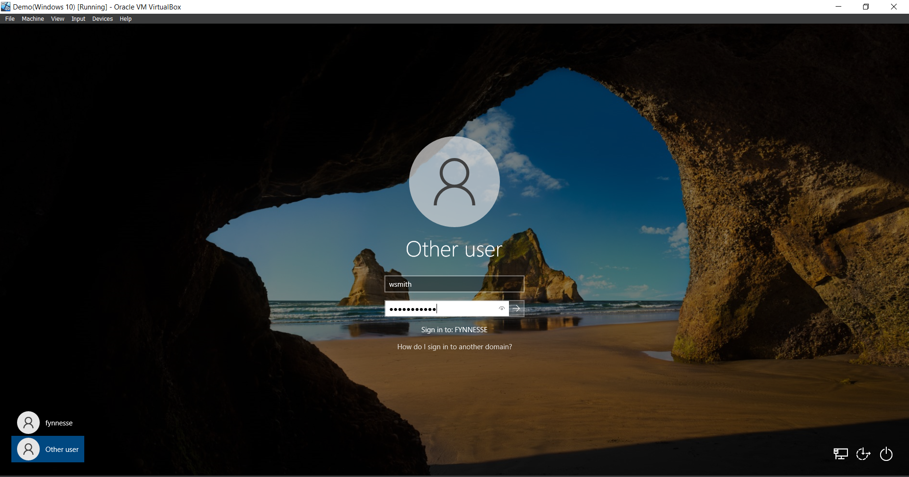
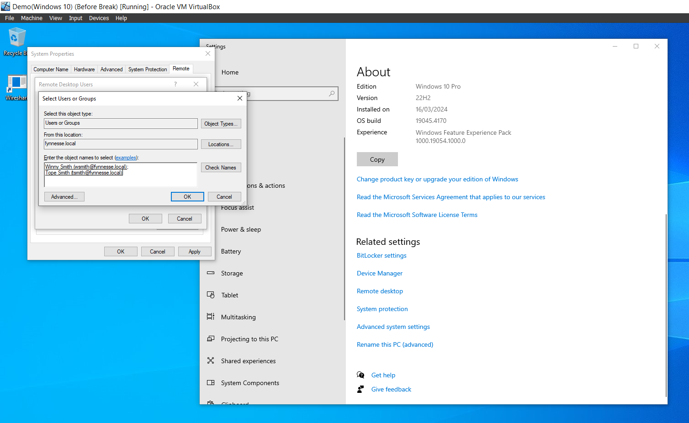
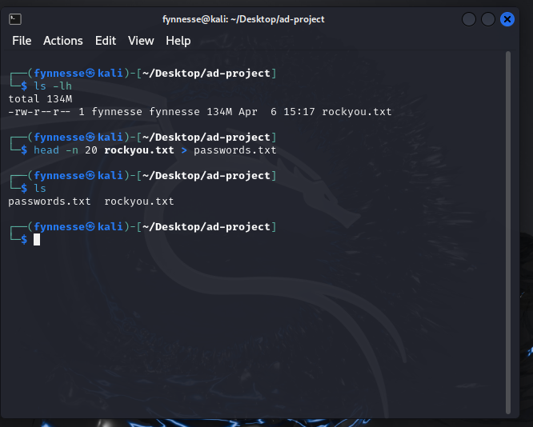
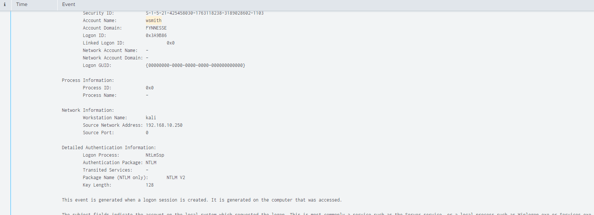
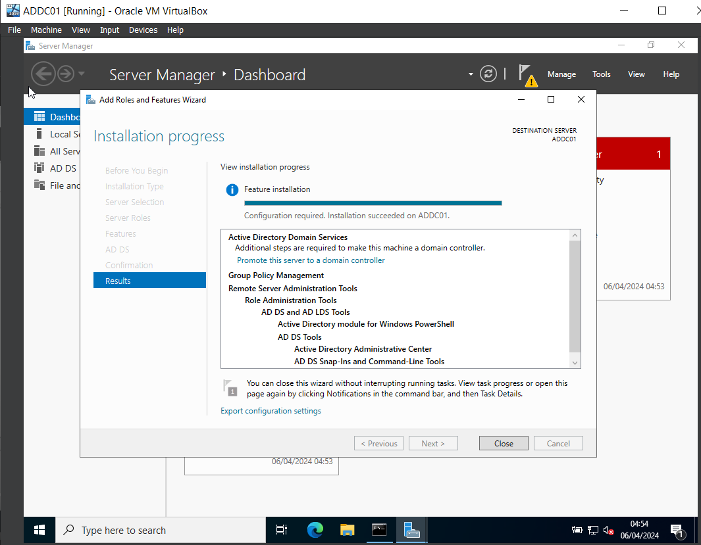
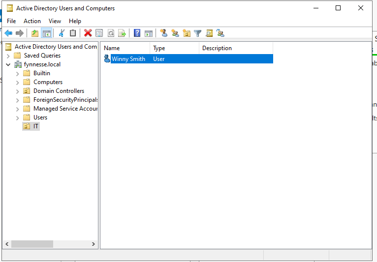

# Active Directory Lab: Attacking a Domain and Finding It in Splunk

**Date:** April 2024

**Environment:** VirtualBox NAT network (192.168.10.0/24): Windows Server 2022 domain controller, Windows 10 domain member, Ubuntu running Splunk Enterprise 9.2.1, Kali Linux attacker

**Report type:** Lab build, attack simulation and log analysis

---

## Summary

I built a small Windows domain (`fynnesse.local`), sent Sysmon and Windows event logs from both Windows machines to Splunk, then attacked it from Kali and with Atomic Red Team to see what each attack looks like in the logs.

Both attacks showed up. The password attack against RDP succeeded: Splunk recorded a successful logon (Event ID 4624) for the domain user `wsmith` from the Kali machine. The Atomic Red Team PowerShell tests (T1059.001) showed up with full Sysmon detail: process, command line, parent process and user.

What's missing: I didn't capture the burst of failed logons (4625) that came before the successful one, and neither attack was turned into a saved alert. Both are covered in [What didn't work](#what-didnt-work).

Built by following [MyDFIR's Active Directory series](https://www.youtube.com/@MyDFIR). The build, configuration and evidence below are from my own environment.

---

## Architecture


| Host | Role | IP | Telemetry |
|---|---|---|---|
| ADDC01 | Windows Server 2022 domain controller for `fynnesse.local` | 192.168.10.7 | Sysmon, Splunk Universal Forwarder |
| TARGET-PC | Windows 10, joined to the domain | DHCP | Sysmon, Splunk Universal Forwarder |
| Splunk | Ubuntu Server running Splunk Enterprise | 192.168.10.10 | Receives on 9997 |
| Kali | Attacker | 192.168.10.250 | None |

The domain has two users: Winny Smith (`wsmith`) in the IT organisational unit, and Tope Smith (`tsmith`). TARGET-PC was joined to the domain so the attacks run against real domain accounts.



---

## Telemetry pipeline

Both Windows machines forward four channels to a Splunk index called `endpoint`. Full file: [`Splunk-Input.conf`](Splunk-Input.conf)

```ini
[WinEventLog://Security]
index = endpoint
disabled = false

[WinEventLog://Microsoft-Windows-Sysmon/Operational]
index = endpoint
disabled = false
renderXml = true
source = XmlWinEventLog:Microsoft-Windows-Sysmon/Operational
```

Application and System logs are also collected. Sysmon runs with [Olaf Hartong's sysmon-modular](https://github.com/olafhartong/sysmon-modular) config, which tags many events with ATT&CK technique IDs.

**Checking the data was arriving.** Before attacking anything, I confirmed both hosts were reporting into the index (6,141 events over 24 hours):


---

## Attack 1: Password attack against RDP

**Setup:** I allowed both domain users to log in over Remote Desktop on TARGET-PC.



On Kali I took the first 20 entries from `rockyou.txt` and added the real password to the end, so the attack would eventually succeed.



**What happened:** Crowbar didn't use the wordlist properly and produced no useful results, so I switched to Hydra.

**What Splunk showed:** a successful logon for `FYNNESSE\wsmith` from workstation `kali` at `192.168.10.250`, authenticated with NTLM. That's the attacker getting in with a guessed password.



**Why this event gives it away:**

- **Workstation name `kali`.** No legitimate machine in this domain is called that. In a real network, an unknown workstation name on a domain logon is worth a look on its own.
- **NTLM, not Kerberos.** Domain-joined machines normally authenticate with Kerberos. An outside machine guessing passwords falls back to NTLM.
- **The source IP is outside the expected set.** 192.168.10.250 isn't one of the domain's machines.

**The alert I'd build:** a successful logon from the same source that just failed many times. That separates a brute force that worked from one that didn't.

```
index=endpoint EventCode IN (4625, 4624)
| stats count(eval(EventCode=4625)) AS failures, count(eval(EventCode=4624)) AS successes BY Account_Name, Source_Network_Address
| where failures > 10 AND successes > 0
```

---

## Attack 2: Atomic Red Team, T1059.001 PowerShell

**Setup:** I installed Invoke-AtomicRedTeam on TARGET-PC and ran the PowerShell technique tests. Commands: [`Powershell-Commands`](Powershell-Commands)

**What Splunk showed:** searching the index for PowerShell activity during the test window returned 286 events. The Sysmon records show the activity on `target-PC.fynnesse.local` under `FYNNESSE\Administrator`, with process paths under `C:\AtomicRedTeam\atomics\T1059.001`:


**Why this matters:** it proves the telemetry is rich enough to build detections on. Sysmon gives the full command line and parent process, which is what you need to tell a download cradle apart from an admin running a script.

---

## Build notes

Two problems I hit while building the Splunk server:

- **The shared folder wouldn't mount.** Adding my user to the `vboxsf` group failed because the group didn't exist. The VirtualBox guest utilities weren't installed. Installing `virtualbox-guest-utils` and rebooting fixed it.

  

- **Splunk came up on the wrong IP.** The server took a DHCP address (192.168.10.4) instead of the planned 192.168.10.10. The forwarders on both Windows machines point at a fixed address, so I set a static IP in netplan.

  

---

## What didn't work

| Issue | What happened | Why it matters | Fix |
|---|---|---|---|
| Crowbar failed | It didn't iterate the wordlist and returned nothing | Lost time on tooling instead of the detection | Switched to Hydra. Test tools on a known-good target first |
| Failed logons not captured | The successful 4624 is evidenced, but not the 4625 burst before it or the Hydra command | Without the failures, the logon alone looks like a user signing in from an odd machine. The pattern is what proves a brute force | Re-run and capture the 4625 burst followed by the 4624 |
| No alerts built | Both attacks were found by searching after the fact | In a SOC, nobody is searching at the right moment | Save the brute force search above as an alert, and add one for PowerShell download cradles and encoded commands |

---

## Reproducing it

- [Step by step guide (PDF)](Active-Directory-Lab-Guide.pdf)
- [Project report (PDF)](Active%20Directory%20Project%20Report.pdf)
- [Windows 10 and Sysmon setup](Windows-10-and-Sysmon-Setup)
- [Splunk inputs.conf](Splunk-Input.conf)
- [PowerShell commands](Powershell-Commands)

**Tools:** Windows Server 2022, Active Directory, Splunk Enterprise, Splunk Universal Forwarder, Sysmon, Kali Linux, Crowbar, Hydra, Atomic Red Team, VirtualBox

**Frameworks:** MITRE ATT&CK T1110.001 (Password Guessing), T1078.002 (Valid Accounts: Domain Accounts), T1059.001 (PowerShell)
