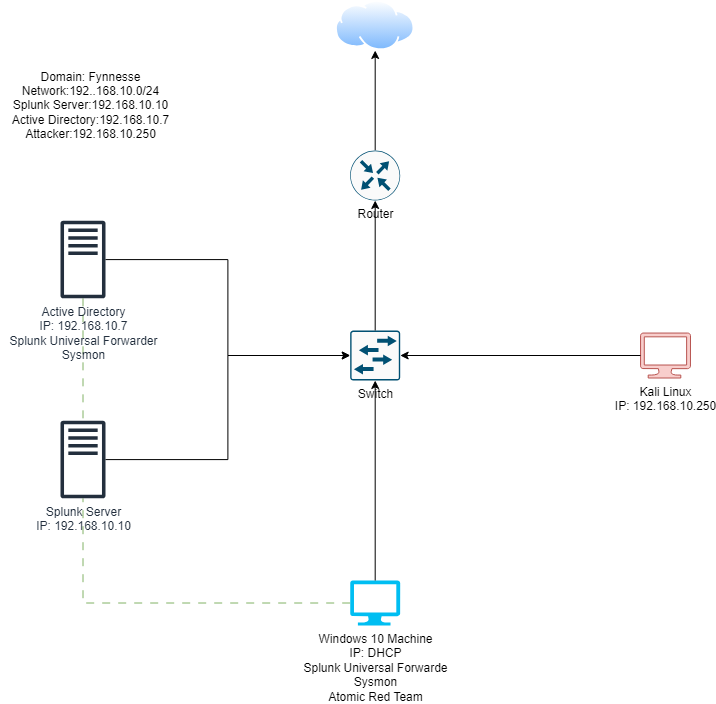
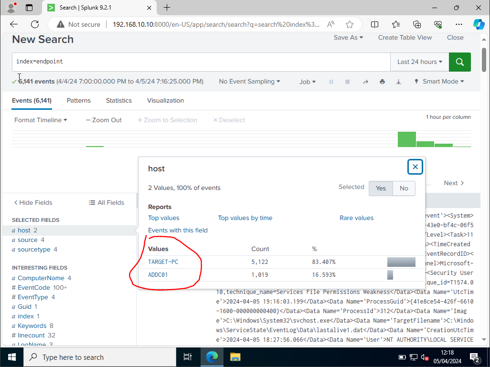
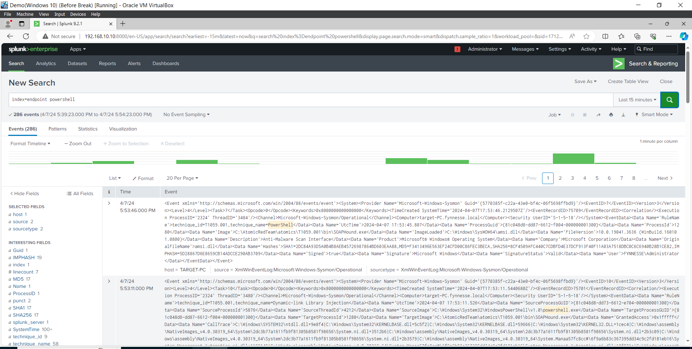

# Active Directory Lab: Attacking a Domain and Finding It in Splunk

**Date:** April 2024

**Environment:** VirtualBox NAT network (192.168.10.0/24): Windows Server 2022 domain controller, Windows 10 domain member, Ubuntu running Splunk Enterprise 9.2.1, Kali Linux attacker

**Report type:** Lab build, attack simulation and log analysis

---

## Summary

I built a small Windows domain (`fynnesse.local`), sent Sysmon and Windows event logs from both Windows machines to Splunk, then attacked it from Kali and with Atomic Red Team to see what each attack looks like in the logs.

The telemetry pipeline worked. Both hosts reported into Splunk, and the Atomic Red Team PowerShell tests (T1059.001) showed up with full Sysmon detail: process, command line, parent process and user. The brute force leg did not go to plan. Crowbar failed to work through the wordlist, so I switched to Hydra. Neither the Hydra run nor the resulting failed logons are captured in this repo, and neither attack was turned into a saved alert. Both gaps are covered in [What didn't work](#what-didnt-work).

Built by following [MyDFIR's Active Directory series](https://www.youtube.com/@MyDFIR). The build, configuration and evidence below are from my own environment.

---

## Architecture



| Host | Role | IP | Telemetry |
|---|---|---|---|
| ADDC01 | Windows Server 2022 domain controller for `fynnesse.local` | 192.168.10.7 | Sysmon, Splunk Universal Forwarder |
| TARGET-PC | Windows 10, joined to the domain | DHCP | Sysmon, Splunk Universal Forwarder |
| Splunk | Ubuntu Server running Splunk Enterprise | 192.168.10.10 | Receives on 9997 |
| Kali | Attacker | 192.168.10.250 | None |

The domain has users in their own organisational units (for example Winny Smith in IT), so the attacks run against real domain accounts.


---

## Telemetry pipeline

Both Windows machines forward four channels to a Splunk index called `endpoint`. Full file: [`Splunk-Input.conf`](Splunk-Input.conf)

```ini
[WinEventLog://Security]
index = endpoint
disabled = false

[WinEventLog://Microsoft-Windows-Sysmon/Operational]
index = endpoint
disabled = false
renderXml = true
source = XmlWinEventLog:Microsoft-Windows-Sysmon/Operational
```

Application and System logs are also collected. Sysmon runs with [Olaf Hartong's sysmon-modular](https://github.com/olafhartong/sysmon-modular) config, which tags many events with ATT&CK technique IDs.

**Checking the data was arriving.** Before attacking anything, I confirmed both hosts were reporting into the index (6,141 events over 24 hours):



---

## Attack 1: RDP brute force

**Setup:** I enabled Remote Desktop on TARGET-PC for both domain users. On Kali I took the first 20 entries from `rockyou.txt` and added the real password to the end, so the attack would eventually succeed.

**What happened:** Crowbar didn't use the wordlist properly and produced no useful results. I switched to Hydra instead.

**What it should look like in Splunk:** a burst of Event ID 4625 (failed logon) for one account from 192.168.10.250, followed by a 4624 (successful logon) when the right password lands. That pattern of many failures then a success is what separates an attack that worked from noise.

```
index=endpoint EventCode=4625
| stats count by Account_Name, Source_Network_Address
| where count > 10
```

That query is the alert I would build next. The 4625 evidence itself isn't captured in this repo.

---

## Attack 2: Atomic Red Team, T1059.001 PowerShell

**Setup:** I installed Invoke-AtomicRedTeam on TARGET-PC and ran the PowerShell technique tests. Commands: [`Powershell-Commands`](Powershell-Commands)

**What Splunk showed:** searching the index for PowerShell activity during the test window returned 286 events. The Sysmon records show the activity on `target-PC.fynnesse.local` under `FYNNESSE\Administrator`, with process paths under `C:\AtomicRedTeam\atomics\T1059.001`:



**Why this matters:** it proves the telemetry is rich enough to build detections on. Sysmon gives the full command line and parent process, which is what you need to separate a download cradle from an admin running a script.

---

## What didn't work

| Issue | What happened | Why it matters | Fix |
|---|---|---|---|
| Crowbar failed | It didn't iterate the wordlist and returned nothing | Lost time on tooling instead of the detection | Switched to Hydra. Test tools on a known-good target first |
| Brute force evidence missing | No capture of the Hydra run or the 4625 events | The attack can't be checked against the logs from this repo | Re-run and capture the 4625 burst and the 4624 that follows |
| No alerts built | Both attacks were found by searching after the fact, not by alerts | In a SOC, nobody is searching at the right moment | Save the 4625 threshold search above as an alert, and add one for PowerShell download cradles and encoded commands |

---

## Reproducing it

- [Step by step guide (PDF)](Active-Directory-Lab-Guide.pdf)
- [Project report (PDF)](Active%20Directory%20Project%20Report.pdf)
- [Windows 10 and Sysmon setup](Windows-10-and-Sysmon-Setup)
- [Splunk inputs.conf](Splunk-Input.conf)
- [PowerShell commands](Powershell-Commands)

**Tools:** Windows Server 2022, Active Directory, Splunk Enterprise, Splunk Universal Forwarder, Sysmon, Kali Linux, Crowbar, Hydra, Atomic Red Team, VirtualBox

**Frameworks:** MITRE ATT&CK T1110.001 (Password Guessing), T1059.001 (PowerShell)
